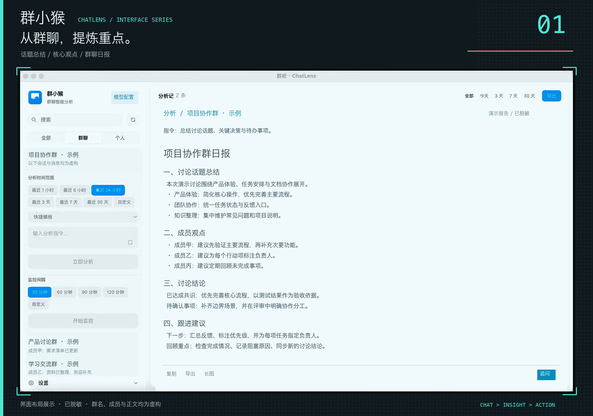
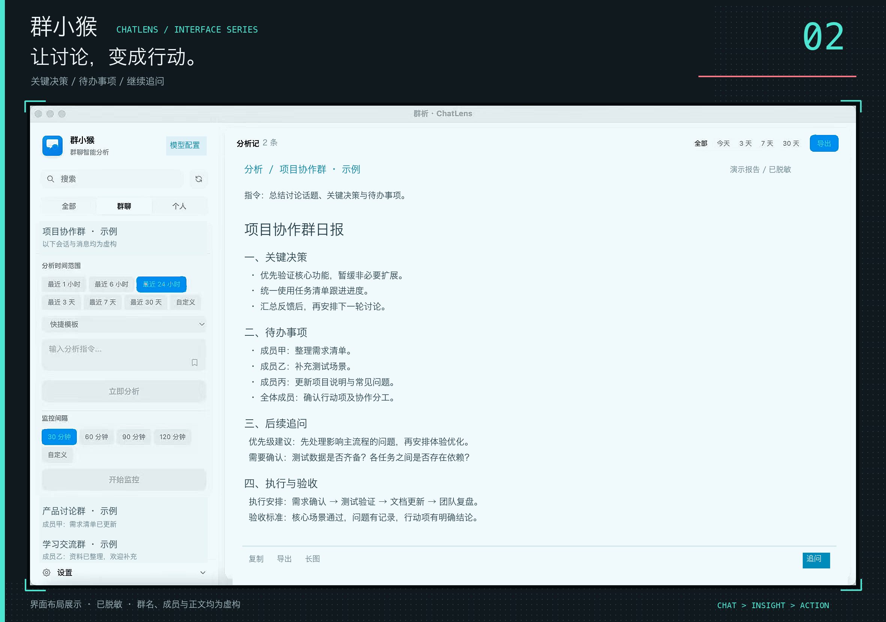

<div align="center">


# 群小猴 · ChatLens

**微信群聊智能分析桌面客户端**

把群聊里的话题、观点与决定，整理成可回顾的日报和可跟进的行动项。

[项目展示](#项目展示) · [核心功能](#核心功能) · [快速开始](#快速开始) · [隐私与使用边界](#隐私与使用边界)

</div>



## 项目介绍

群消息太多，没时间逐条翻阅？讨论持续了很久，却不知道最终决定了什么？

群小猴将微信会话、时间筛选、AI 分析和历史记录放在同一个桌面工作区。选择一个群聊和时间范围，使用快捷模板或输入自己的问题，即可将零散对话整理成结构化内容；需要进一步了解细节时，可以继续追问，并将结果复制或导出。

适合以下场景：

- **社群运营**：回顾热门话题、成员观点与高频问题，整理社群日报。
- **项目协作**：提炼讨论中的决策、待办事项和提到的负责人。
- **学习交流**：总结技术讨论，梳理有价值的观点和知识线索。
- **持续关注**：为指定群聊设置分析指令与监控间隔，定期查看新动态。

## 项目展示

基于真实运行截图制作科技风展示，保留会话选择、时间筛选、分析报告与追问等原始功能布局。



> 展示图以运行截图为基础，经本地调色、锐化与科技漫画风排版处理，并非应用的新主题。图片已脱敏：群名、成员名、时间、消息预览与报告正文均已覆盖并替换为虚构示例。图中“模型配置”为展示文案调整，不代表程序按钮已修改。制作信息见 [图片说明](docs/images/README.md)。

## 核心功能

| 功能 | 可以做什么 |
| --- | --- |
| 会话筛选 | 搜索会话，在全部、群聊和个人会话之间切换 |
| 时间范围 | 使用快捷时间范围或自定义起止时间，聚焦需要回顾的讨论 |
| AI 分析 | 按指令总结聊天内容、提取观点、整理决策与行动项 |
| 快捷与自定义模板 | 复用常用分析任务，也可保存自己的指令 |
| 定时监控 | 为群聊设置指令与监控间隔，持续分析新消息 |
| 历史记录 | 集中查看分析结果，按群聊与时间筛选 |
| 结果追问 | 围绕已有分析继续提问，补充细节 |
| 复制与导出 | 复制结果、导出 Markdown 或生成长图 |
| 本地持久化 | 在本机保存分析记录、监控配置与设置 |

## 快速开始

### 1. 准备环境

- Node.js 与 npm：需满足锁定依赖的运行要求；本地安装 Electron 时使用 Node.js 24 完成了解压。
- 微信桌面客户端：读取聊天数据前需运行并登录。
- 与本项目命令格式兼容的 `wechat-cli`，以及该版本要求的 Python 环境。

本项目包含 macOS 和 Windows 打包配置。应用窗口能够启动，不代表微信数据读取已完成配置；后者还取决于微信版本、工具兼容性和系统权限。

### 2. 安装并启动

```bash
git clone https://github.com/XiaoJ123-BIT/qunxiaohou.git
cd qunxiaohou
npm ci
npm run dev
```

### 3. 配置微信数据读取

本项目调用的是以下形式的命令：

```bash
wechat-cli sessions --format json --limit 200
wechat-cli history "群聊名称" --format json
```

请先确认安装的工具支持这些命令，再在应用「设置」中填写可执行文件的绝对路径。

> **兼容性提示（2026-10-19 核对）**：不要仅凭包名直接安装。当前 PyPI 的同名包与本项目需要的命令格式不同；原 README 指向的依赖仓库也暂时无法访问。本地已验证 `huohuoer/wechat-cli` 源码版本可以安装、显示帮助并被应用调用，但尚未完成真实微信数据读取验证。这不等于完整兼容性或安全审计结论。

该源码版本可采用独立 Python 环境安装，不影响系统 Python：

```bash
git clone https://github.com/huohuoer/wechat-cli.git ../wechat-cli
# 该源码版本要求 Python 3.10 或以上
python3 -m venv ../wechat-cli/.venv
../wechat-cli/.venv/bin/python -m pip install ../wechat-cli
../wechat-cli/.venv/bin/wechat-cli --help
```

以上为 macOS/Linux 终端路径写法；Windows 虚拟环境中的可执行文件位于 `Scripts` 目录。

**初始化前请阅读所选工具的源码及说明。** 某些版本的 `init` 会提取数据库密钥，并在权限不足时尝试重新签名微信。重新签名会改变应用的安全属性，可能影响部分功能或更新；不要将其当作无风险的常规安装步骤，也不要为此关闭系统安全保护。

### 4. 配置 AI 服务

在左下角「设置」中检查并保存：

| 配置项 | 说明 |
| --- | --- |
| API Key | 使用的 AI 服务凭据，请勿提交到代码仓库 |
| 模型 | 服务实际支持的模型名称 |
| API Base URL | AI 服务接口基础地址，调用使用 `/chat/completions` 路径 |
| wechat-cli 路径 | 工具可执行文件的绝对路径；留空时应用尝试自动检测 |

项目带有默认服务配置。分析前请确认实际请求地址、服务条款及计费方式，不要直接假定默认配置适合处理敏感内容。

### 5. 发起一次分析

1. 在左侧选择并展开目标群聊。
2. 选择时间范围，例如最近 24 小时。
3. 选择「生成日报」等快捷模板，或输入自定义分析指令。
4. 点击「立即分析」，在右侧查看结果。
5. 按需追问、复制或导出；需要定期分析时再开启监控。

## 开发与构建

```bash
npm run dev       # 开发模式
npm run build     # 编译主进程、预加载脚本与界面
npm start         # 启动已构建的应用
npm run dist      # 打包；请先执行 npm run build
```

项目另提供 `dist:mac`、`dist:win` 和 `dist:all` 脚本，具体打包要求以 Electron Builder 的目标平台支持和本机环境为准。

| 模块 | 技术 |
| --- | --- |
| 桌面应用 | Electron |
| 界面 | React + TypeScript |
| 样式 | Tailwind CSS |
| 状态管理 | Zustand |
| 本地数据库 | sql.js |
| 开发与构建 | electron-vite + Electron Builder |
| 微信数据读取 | 外部 `wechat-cli` 工具 |

## 隐私与使用边界

- 仅处理你有权访问和分析的聊天内容，并尊重群成员的隐私。
- **AI 分析并非完全离线**：所选聊天内容及分析指令会发送至配置的 AI 接口；开启监控后也会持续发起分析请求。
- 分析记录、设置以及微信读取工具生成的数据保存在本机，但本地保存不等于加密保存。妥善保护 API Key、数据库密钥和聊天记录，不要上传到公开仓库。
- 分享截图或导出报告前，请检查群名、成员信息及聊天内容是否需要脱敏。
- AI 可能遗漏信息或产生错误。重要决策、负责人和待办事项应回到原始聊天记录核实。

## 反馈与贡献

欢迎通过 [Issues](https://github.com/XiaoJ123-BIT/qunxiaohou/issues) 反馈问题或提出功能建议，也欢迎提交 Pull Request。

反馈时请说明操作系统、微信版本、工具版本、复现步骤和脱敏后的错误信息，不要附带密钥或私人聊天记录。

## License

项目元数据声明为 MIT；仓库当前尚未包含独立的 `LICENSE` 文件。
